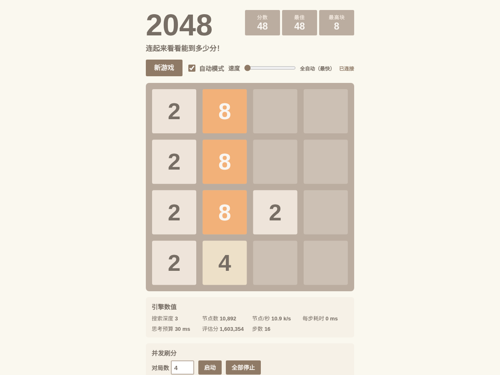

<div align="center">

# ai2048

**Rust 版 2048 AI 服务器** —— 位棋盘 expectimax 引擎 + 零依赖 WebSocket 服务器 + 经典 2048 网页界面

[](https://github.com/masgzy/2048ai-rust/actions/workflows/ci.yml)
[](https://github.com/masgzy/2048ai-rust/actions/workflows/build.yml)
[](https://github.com/masgzy/2048ai-rust/releases)
[](LICENSE)
[](Cargo.toml)
[](Cargo.toml)
[](src/)
[](#下载预编译二进制)

**[特性](#特性) · [快速开始](#快速开始桌面) · [下载安装](#下载预编译二进制) · [配置](#配置) · [协议](#websocket-协议wsjson-文本帧) · [参与贡献](#参与贡献) · [Changelog](CHANGELOG.md)**

</div>

---

单文件 Go 版的完全 Rust 重构。**零第三方依赖**（纯 `std`），任何能装 Rust 的平台都能编译，
包括 Android/Termux 与 arm64。当前版本 **v1.0.0-alpha.1**（见 [CHANGELOG](CHANGELOG.md)）。



## 特性

- **强**：位棋盘 + 置换表 + 迭代加深的 expectimax，方向级并行；自对弈 8192 达成率 2/2（详见[性能与强度](#性能与强度)）
- **快**：35 ~ 70M 节点/秒（视核数），思考预算全自动（开局毫秒级、残局自动加时，实测平均每步 40ms）
- **零依赖**：`Cargo.toml` 没有一个 `[dependencies]`——HTTP/WebSocket/SHA1/base64/JSON 全部手写，
  供应链攻击面为零，`cargo audit` 永远安静
- **单文件**：服务器是一个静态二进制，网页界面内嵌其中，无前端构建步骤
- **安全默认**：只监听 `127.0.0.1:8080`，WebSocket 同源校验，请求头/消息长度/连接数/超时全部设限
- **可训练**：内置 TD(0) 自博弈强化学习器（`train`）与无头基准工具（`simulate`）
- **跨平台**：CI 构建并校验 Linux（musl 静态）/ Windows / Android（4 ABI，16KB 页对齐）等 6 个目标

## 目录

<!-- toc -->

- [特性](#特性)
- [性能与强度](#性能与强度)
- [快速开始](#快速开始桌面)
- [下载预编译二进制](#下载预编译二进制)
- [配置](#配置)
- [Termux（Android 手机）部署](#termuxandroid-手机部署)
- [网页界面（经典 2048 风格）](#网页界面经典-2048-风格)
- [WebSocket 协议（/ws，JSON 文本帧）](#websocket-协议wsjson-文本帧)
- [安全边界](#安全边界)
- [强化学习（OTD+TC 训练器）](#强化学习otdtc-训练器)
- [Tile-downgrading 搜索（TDL2048+ 的 Tile-DG）](#tile-downgrading-搜索tdl2048-的-tile-dg)
- [CLI 配色（Catppuccin）](#cli-配色catppuccin)
- [基准工具](#基准工具)
- [项目结构](#项目结构)
- [持续集成与构建（GitHub Actions）](#持续集成与构建github-actions)
- [相比 Go 版修复的 Bug 与优化](#相比-go-版修复的-bug-与优化)
- [参与贡献](#参与贡献)
- [许可证](#许可证)
- [致谢](#致谢)

<!-- /toc -->


## 性能与强度

- 吞吐：**35 ~ 70M 节点/秒**（视 CPU 核数；2 核沙盒实测 `simulate --games 2` 全程平均 49.1M/s；
  GitHub 标准 runner 是 4 vCPU，应更快；自编译加 `target-cpu=native` 还能再快）
- 强度：全自动预算（默认最高速度）下自对弈实测 **8192 达成率 2/2**（130,264 / 159,192 分，平均每局 6062 步），
  4096 常规达成
- 移动思考预算完全自动：按空格数与局面复杂度自适应（开局 ~毫秒级，残局自动加时，实测平均每步 40ms）
- 内存占用：每个搜索线程一张约 1.7MB 的置换表（128K 条 × 13 字节）；对象池复用（最多缓存 32 张，约 55MB），
  搜索期零分配

## 快速开始（桌面）

```bash
cargo build --release          # 需要 Rust 1.82 或更高版本
./target/release/ai2048        # 默认监听 127.0.0.1:8080
# 浏览器打开 http://127.0.0.1:8080/
```

可选性能压榨（本机原生指令集自动向量化）：

```bash
RUSTFLAGS="-C target-cpu=native" cargo build --release
```

## 下载预编译二进制

从 [Releases](https://github.com/masgzy/2048ai-rust/releases) 下载对应平台的压缩包，
每个包内含 `ai2048`（服务器）、`simulate`（基准）、`train`（训练器）、README、LICENSE 与 `SHA256SUMS`。

| 平台 | 文件（v1.0.0-alpha.1） | 形态 |
| --- | --- | --- |
| Linux x86_64 | `ai2048-1.0.0-alpha.1-linux_amd64.tar.gz` | musl 纯静态，任何发行版直接跑 |
| Windows x64 | `ai2048-1.0.0-alpha.1-windows_amd64.zip` | `ai2048.exe` |
| Android arm64（Termux） | `ai2048-1.0.0-alpha.1-android_arm64.tar.gz` | bionic 动态链接，16KB 页对齐 |
| Android armv7 | `ai2048-1.0.0-alpha.1-android_armv7.tar.gz` | 同上 |
| Android x86 / x86-64 | `ai2048-1.0.0-alpha.1-android_x86[_-64].tar.gz` | 同上（模拟器） |

```bash
tar xzf ai2048-1.0.0-alpha.1-linux_amd64.tar.gz
cd ai2048-1.0.0-alpha.1-linux_amd64
sha256sum -c SHA256SUMS          # 校验完整性
./ai2048                          # 默认监听 127.0.0.1:8080
```

> 每次推送 `main` 也会产出 CI 构建产物（[Actions](https://github.com/masgzy/2048ai-rust/actions/workflows/build.yml)，
> 保留 14 天），与 Release 同源同校验，只是没有版本号命名。
> 需要 musl 之外的 Linux 架构（armv5/armv6/armv7/arm64/386）或针对性优化（`target-cpu=native`）时，
> 从源码编译只需一条 `cargo build --release`（零依赖，无需任何交叉工具链）。

## 配置

服务器默认**只监听 `127.0.0.1:8080`**（仅本机可访问）；需要局域网访问时须显式配置（见本节末尾的安全提示）。

命令行选项（`ai2048 --help`）：

| 选项 | 说明 |
| --- | --- |
| `--config, -c <path>` | 配置文件路径。不指定时查找当前目录的 `config.json`，存在才加载 |
| `--host <addr>` | 监听地址，默认 `127.0.0.1`；`0.0.0.0` 表示所有 IPv4 接口 |
| `--port, -p <n>` | 监听端口，默认 `8080` |
| `--weights, -w <path>` | TD 权重文件，默认 `weights.json`（不存在则用内置启发式） |
| `--version, -V` / `--help, -h` | 显示版本 / 帮助 |

配置文件是 JSON，字段全部可选，只写要改的字段。模板见 [`config.example.json`](config.example.json)：

```json
{
  "host": "127.0.0.1",
  "port": 8080,
  "weights": "weights.json",
  "max_connections": 256,
  "idle_timeout_secs": 300
}
```

| 字段 | 默认值 | 取值范围 | 说明 |
| --- | --- | --- | --- |
| `host` | `"127.0.0.1"` | 主机名或 IP | 监听地址 |
| `port` | `8080` | 1 ~ 65535 | 监听端口 |
| `weights` | `"weights.json"` | 非空字符串 | TD 权重文件路径 |
| `max_connections` | `256` | 4 ~ 100000 | 并发连接上限，超出立即回 `503` |
| `idle_timeout_secs` | `300` | 1 ~ 86400 | WebSocket 连接空闲多少秒后断开 |

规则：

- 优先级：内置默认值 < `config.json` < 命令行参数
- `--config` 显式指定的文件读不到、不是合法 JSON 或字段越界：打印原因，退出码 2
- 默认路径 `./config.json` 仅在存在时加载；加载失败则打印警告并退回默认值
- 未知字段忽略

局域网访问（谨慎）：服务**没有身份认证与传输加密**，暴露后同一网络内的任何人都能让它跑引擎（占用 CPU）。
只在可信网络中这样做，不要直接暴露到公网；确有需要请放在带鉴权的反向代理之后，并把 `max_connections` 调低。

```bash
./target/release/ai2048 --host 0.0.0.0     # 命令行
HOST=0.0.0.0 bash termux.sh                 # Termux
# 或写进 config.json：{"host": "0.0.0.0"}
```

## Termux（Android 手机）部署

> **2026-11 已知坑**：Termux 官方 `rust` 包当前缺少 std 静态库（rlib），
> 本地工程 `cargo build` 会报一串
> `crate `std` required to be available in rlib format, but was not found in this form`
> （std / core / alloc / compiler_builtins / libc …）。
> 这是 Termux 打包缺陷（termux-packages issue #31547），**与本项目代码无关**。

### 方式一（推荐）：直接运行预编译静态二进制，无需任何 Rust 环境

仓库 `prebuilt/` 目录附带 aarch64 纯静态二进制（`aarch64-unknown-linux-musl`，
三个文件各约 0.43 ~ 0.58 MB；Android 5.0+ 的 arm64 手机直接运行，不依赖 Termux 的 Rust）。

```bash
bash termux.sh        # 自动检测 prebuilt/ 并启动，默认只监听手机本机 127.0.0.1:8080
```

手动等价操作：

```bash
chmod +x prebuilt/ai2048-android-aarch64
termux-wake-lock      # 防止息屏后杀后台
./prebuilt/ai2048-android-aarch64 --port 8080
```

### 方式二：源码编译（需要可用的 Rust）

Termux 自带 rust 包有问题时，改用 rustup 工具链即可：

```bash
pkg install -y clang binutils
curl --proto '=https' --tlsv1.2 -sSf https://sh.rustup.rs -o /tmp/rustup-init.sh
sh /tmp/rustup-init.sh -y --profile minimal
export PATH="$HOME/.cargo/bin:$PATH"   # 关键：别让 Termux 的 rustc 抢在前面
bash termux.sh --build                 # 或手动：
# RUSTFLAGS="-C target-cpu=native" cargo build --release --bin ai2048
```

（Termux 日后修复 rust 包的话，`apt install --reinstall rust` 换回官方包也可以。）

- 手机浏览器打开 `http://127.0.0.1:8080/`
- 局域网内电脑访问：`HOST=0.0.0.0 bash termux.sh` 启动（默认只监听本机），`ifconfig wlan0` 查看手机 IP，
  浏览器打开 `http://<手机IP>:8080/`
- 一键脚本：`bash termux.sh`（加 `--build` 强制源码编译；`PORT=9000` 换端口）
- RL 训练也能在手机上跑：`./prebuilt/train-android-aarch64 --games 2000`

> arm64 说明：全部代码为可移植标量 Rust（位运算 + 查表），aarch64 基线自带 NEON，
> LLVM 自动向量化即可利用；预编译二进制按通用 aarch64 目标出包以兼容所有机型，
> 自编译加 `target-cpu=native` 可针对你的 SoC（骁龙/天璣/麒麟）进一步优化。
>
> 预编译文件为 v1.0.0-alpha.1 源码的构建产物，已通过 ELF 结构校验（纯静态、无解释器、aarch64），
> 但构建环境不是 Android 手机，未在真机上运行验证；如遇问题请用方式二自行编译。

## 网页界面（经典 2048 风格）

- 视觉严格复刻原版 2048（Gabriele Cirulli，MIT）的配色与排版，米色背景、经典瓦片色阶、
  分数/最佳/最高块计分板、Game over 遮罩；已做移动端适配与触摸滑动，并显式声明
  `color-scheme: only light` 防止手机浏览器强制暗色反转。
- **自动模式**（默认开启）：AI 连续对局，结束自动开新局重试，8192 达成后自动继续。
- **速度滑杆**：默认 0 = 全自动思考预算（最高速度）；拖大于 0 表示每步至少思考相应毫秒（观看模式）。
  自动预算永远按局面复杂度工作，滑杆只是“最短思考时间”下限，与预算算法无关。
- **并发刷分**：1~8 个独立对局（各自 WebSocket 连接）同时运行并自动重开，
  汇总显示总分/最高单局/8192 次数，主局面与并发局全部计入战绩。
- **引擎数值**：每步的搜索深度、节点数、节点/秒、每步耗时、思考预算、评估分、步数。
- 键盘（方向键 / WASD）或滑动即切回手动模式；分数最佳记录存 localStorage。
- 页脚常驻许可证（AGPL-3.0-or-later）与本仓库源码地址。

## WebSocket 协议（`/ws`，JSON 文本帧）

握手就是标准的 RFC 6455 升级请求。用 curl 试一次（不带 `Origin` 的非浏览器客户端被允许）：

```bash
curl -i -N --http1.1 http://127.0.0.1:8080/ws \
  -H 'Connection: Upgrade' -H 'Upgrade: websocket' \
  -H 'Sec-WebSocket-Version: 13' -H 'Sec-WebSocket-Key: dGhlIHNhbXBsZSBub25jZQ=='
# HTTP/1.1 101 Switching Protocols
# Sec-WebSocket-Accept: s3pPLMBiTxaQ9kYGzzhZRbK+xOo=
```

客户端 → 服务端：

```json
{"type":"hello"}
{"type":"move","id":7,"board":[[2,0,0,2],[0,4,0,0],[0,0,0,0],[2,0,0,0]],"min_ms":0}
```

- `board`：4x4 实际牌值（0=空，2,4,…,32768），必须为 2 的幂，非法输入返回 error 不 panic
- `min_ms`：0 = 全自动思考预算；>0 = 每步最短思考毫秒（上限 5000）
- `max_depth`（可选）：搜索深度上限，钳制在 1 ~ 12，默认 12（正常无需传）
- 客户端发出的帧**必须带掩码**；单条消息（分片累计）上限 64KB，单帧上限 1MB

服务端 → 客户端：

```json
{"type":"hello","cores":8,"weights":"内置启发式","version":"1.0.0-alpha.1","engine":"rust-bitboard-expectimax"}
{"type":"move","id":7,"dir":1,"score":1489264.0,"depth":9,"nodes":3260280,"ms":105,"budget":100,"nps":31050285}
{"type":"error","id":99,"error":"非法方块值 3（必须为 2 的幂且 <= 32768）"}
```

- **方向编码：0=左，1=右，2=上，3=下**（与前端一致）
- `dir` 为 0~3；收到后自行应用移动与随机生成块，再把新盘面发回来求下一步
- 其它错误信息：`缺少 type 字段`、`未知消息类型 X`、`JSON 解析失败: …`、`缺少 board 数组`、
  `board 必须为 4x4`、`board 含非法方块值`；引擎内部异常返回 `引擎内部错误`，连接不断开

## 安全边界

默认只监听回环地址是第一道防线；下面是纵深防御，数值都是源码常量（`src/http.rs`、`src/ws.rs`）。

| 环节 | 限制 | 违反时 |
| --- | --- | --- |
| 请求头 | 首行 + 全部头行总长 ≤ 16KB，最多读 64 行 | 超长回 `431` 并断开 |
| 请求头读取时限 | 总时限 15 秒（绝对截止时间，每隔几秒滴 1 个字节也会被切断） | 到期直接断开，不回响应 |
| 写超时 | 30 秒 | 断开 |
| 方法 | 仅 `GET` | 其它方法回 `405` 并带 `Allow: GET` |
| `/ws` 升级 | 必须带 `Upgrade: websocket`、`Connection: Upgrade`、`Sec-WebSocket-Version: 13`、非空 `Sec-WebSocket-Key` | 否则回 `400` |
| 同源校验 | 见下 | 否则回 `403` |
| WebSocket 帧 | 客户端帧必须带掩码；单帧 ≤ 1MB；控制帧不分片且 ≤ 125 字节 | 违规直接断开 |
| WebSocket 消息 | 分片累计 ≤ 64KB（防止大量小分片绕过单帧上限） | 断开 |
| 并发连接 | 默认 256（`max_connections`），线程退出、panic 或创建失败都会归还额度 | 超出回 `503` 并断开 |
| 空闲连接 | WebSocket 阶段默认 300 秒无数据（`idle_timeout_secs`） | 断开 |
| 引擎异常 | 每步计算包在 `catch_unwind` 里 | 返回 error，连接不断 |
| `move` 请求 | `min_ms` 钳制到 ≤ 5000，`max_depth` 钳制到 1 ~ 12 | — |

同源校验规则（防公网页面 drive-by 驱动本机引擎）：

- 不带 `Origin`（curl、脚本、无头工具等非浏览器客户端）：允许
- `Origin` 的 `主机[:端口]` 与 `Host` 头一致（本服务自己提供的页面，含同域反向代理）：允许
- `Origin` 的主机是 `localhost`、`127.0.0.1` 或 `[::1]`（本机其它端口上的页面）：允许
- 其它一律拒绝，`Origin: null`（file:// 页面、沙箱 iframe）也拒绝

仍然存在的边界：没有鉴权、限流和加密；同源校验不是身份验证，任何非浏览器客户端都可以不带 `Origin`。
一条连接同一时刻只处理一个 `move` 请求，每个请求最多起 4 条搜索线程（每个合法方向一条）。

## 强化学习（OTD+TC 训练器）

`train` 是自博弈 TD 强化学习器，方法族与当前最强的开源 2048 学习框架
**TDL2048+**（[moporgic/TDL2048](https://github.com/moporgic/TDL2048)，MIT；
Guei, Chen & Wu, *Optimistic Temporal Difference Learning for 2048*,
IEEE TG 2021）同源：

- **OTD（乐观 TD）**：特征权重初始化为 `Vinit / 8`（默认 Vinit=80000）。
  未访问状态估值偏高 → 贪心策略主动探索；访问后回落 → 转向其它少访问状态。
  这是论文推荐的探索机制（ε-greedy 在 2048 上反而有害）。
- **TC（temporal coherence）**：每个权重维护 δ 的累计和 E 与 |δ| 累计 A，
  有效学习率按 β = |E|/A 逐权重调制——方向反复翻转的权重自动减速，
  一致方向的保持全速。
- **OTD+TC 两阶段**（默认）：前 90% 局 OTD（α=0.1 充分探索），
  后 10% 切 TC 微调快速收敛（`--ptc` 可调）。
- **多阶段（multistage）**：默认两阶段（本局出现 8192 后切第二张权重表，
  `--stages 8192,16384` 可开三阶段），缓解大块状态训练样本不足。
- **多线程**：`--threads N` 每线程独立网络自博弈（无锁竞争），
  每 `--merge-every` 局全网络平均合并（TDL2048 的 20 线程 lock-free
  optimistic 并行的保守变体）。2 vCPU 沙盒实测 4 线程吞吐 ×2.25。
- 价值函数与引擎评估同构：V(board) = Σ(4 行 + 4 列) 查同一张 65536 项表
- 产出 `weights.json`，`ai2048` 服务器启动时**自动加载**（页脚显示"评估: TD 学习权重"）

```bash
# 快速体验（弱，仅供验证流程）
cargo run --release --bin train -- --games 500
# 认真训练：4 线程 100 万局（实测约 19k 局/秒/2vCPU；更强机器线性加速）
cargo run --release --bin train -- --games 1000000 --threads 4 --out weights.json
# 纯 OTC / 纯 OTD / 单阶段
cargo run --release --bin train -- --games 50000 --mode otc
cargo run --release --bin train -- --games 50000 --mode otd --stages ""
# 断点续训（多阶段文件向后兼容单阶段旧格式）
cargo run --release --bin train -- --games 50000 --resume weights.json
```

**与 TDL2048+ 的差距（如实声明）**：本实现是零依赖单二进制工程的教学级配置，
元组网络为 4x4 行列 8 元组（TDL2048+ 的 SOTA 用 Matsuzaki 8x6-tuple +
100M 局 + 20 线程 SHM 无锁共享），论文成绩为平均 625,377 分、72% 32768 达成
（6-ply 搜索）。本实现 10 万局热身水平约 2.5 万分（2048 达成 45%），
要逼近论文数字需要 8x6 元组 + 数百万局以上训练量。

参数错误（未知参数、`--games 0`）会打印用法并以退出码 2 结束；`train --help` 列出全部参数。

诚实预期：TD 线性价值函数需要数万局才能逼近甚至超过手调启发式；
训练期间可用 `simulate` 随时评估（见下）。不训练也完全不影响使用——
默认的 nneonneo 式启发式 + expectimax 已经是 2048 公认最强算法组合。

## Tile-downgrading 搜索（TDL2048+ 的 Tile-DG）

`simulate --dg` 启用 tile-downgrading expectimax（论文第 IV-C.3 节）：
根盘面满足**存在 32768+ 大块**且**存在缺失中间块**时，把所有大于最大缺失块的
块减半得到"降级盘面"，在降级盘面上搜索，选出的方向直接作用于原盘面。
动机：评估函数对极大块状态训练不足、估值偏差大，降级后的状态与中小块
状态分布重合、估值更准；论文中该技术把 32768 达成率从 65% 提到 72%。

```bash
./simulate --games 10 --min-ms 50 --dg   # 冲击 32768 的推荐配置
```

（服务器端与网页端暂未接 `--dg`；内置启发式评估不走 TD 表，收益有限，
等 TD 权重成熟后再接入。）

## CLI 配色（Catppuccin）

`train` / `simulate` / `ai2048` 的输出按 [Catppuccin](https://catppuccin.com/palette/)
配色（Mocha 深色 / Latte 浅色），色值内置自官方 palette v3.0.0
（零依赖工程不引 crate，常量旁注明来源）：

- 语义化着色：标题 mauve、成功 green（前缀 `OK`）、警告 peach（`!`）、
  错误 red（`X`）、信息 sky（`i`）、数字 yellow、路径 blue
- 切换：`--theme mocha|latte` 或环境变量 `CLI_THEME`
- 降级链（社区规范顺序）：
  `--color=never` > `NO_COLOR`(非空) > `TERM=dumb` > `CLICOLOR=0`
  > `--color=always` > `FORCE_COLOR`/`CLICOLOR_FORCE` > TTY 自动探测；
  降级后零 ANSI 残留，语义靠 ASCII 前缀保持可读
- 符号前缀用 ASCII（`OK`/`X`/`!`/`i`），不用 `✓✗⚠ℹ`，避免 CI 日志乱码

## 基准工具

```bash
cargo run --release --bin simulate -- --games 4 --seed 99
#   --games N      对局数（默认 10）
#   --min-ms 0     全自动预算（与网页默认一致）
#   --max-depth N  搜索深度上限（默认 12）
#   --dg           启用 tile-downgrading（见上节）
#   --ref-depth 5  参考模式：纯递归无 TT 版本，用于交叉验证
#   --weights PATH TD 权重文件
```

输出每局分数/最高块、达成率、全程累计的平均节点/秒与平均每步耗时。

## 项目结构

```text
2048ai-rust/
├── Cargo.toml              # 零依赖；release: LTO + codegen-units=1 + strip；MSRV 1.82
├── CHANGELOG.md            # 变更日志（Keep a Changelog 风格）
├── config.example.json     # 配置文件模板（复制为 config.json 后按需修改，config.json 不入库）
├── termux.sh               # Android 一键启动（默认用预编译版，--build 源码编译）
├── prebuilt/               # aarch64 纯静态预编译二进制（Termux 直接跑）
├── docs/                   # 文档资源（界面截图等）
├── THIRD_PARTY_NOTICES.md  # 第三方 MIT 许可声明
├── .github/
│   ├── workflows/
│   │   ├── ci.yml          # rustfmt / clippy / MSRV / 测试（Linux + Windows）/ 冒烟
│   │   └── build.yml       # 交叉编译矩阵 + ELF 校验 + 打包 + Release
│   ├── releases/           # 按版本存放的 release note（build.yml 发布时使用）
│   └── scripts/            # check_elf.py / smoke.py / package.py / release_pack.py / android_linker.py
└── src/
    ├── lib.rs
    ├── board.rs          # 位棋盘、65536 项行表、转置、RNG（含朴素实现对照测试）
    ├── eval.rs           # 启发式行表（nneonneo 权重）+ TD 权重加载
    ├── engine.rs         # expectimax、TT 对象池、迭代加深、方向级并行、自动预算、Tile-DG
    ├── learn.rs          # OTD/OTC/OTD+TC 学习器 + 多阶段网络（TDL2048+ 同族方法）
    ├── json.rs           # 极简 JSON 解析/转义
    ├── ws.rs             # RFC6455 + SHA1 + base64（含 RFC 向量测试）
    ├── http.rs           # 极简 HTTP 服务 + 路由 + 限制与超时
    ├── color.rs          # CLI 配色（Catppuccin Mocha/Latte + NO_COLOR/dumb 降级链）
    ├── ui.rs             # 内嵌前端
    ├── index.html        # 经典 2048 界面（单文件，无外部资源）
    ├── main.rs           # 服务器入口：配置文件 + 命令行
    └── bin/
        ├── train.rs      # TD 强化学习训练器
        └── simulate.rs   # 无头自对弈基准
```

## 持续集成与构建（GitHub Actions）

**CI（`ci.yml`）**：推送到 `main`、推送 `v*` 标签、Pull Request 或手动触发时运行。

- `rustfmt`：`cargo fmt --all --check`
- `clippy`：`cargo clippy --all-targets --locked -- -D warnings`
- `MSRV 1.82`：`cargo +1.82 check --all-targets --locked`
- `测试 (ubuntu-24.04)` 与 `测试 (windows-latest)`：debug 与 release 各跑一遍 `cargo test`，
  构建 release 二进制后让 `simulate` 走一局（`--games 1 --max-depth 3`）、`train` 训练 2 局，
  再用 `.github/scripts/smoke.py` 对真实服务器做端到端冒烟：默认端口与回环监听、配置文件与
  `--port` 覆盖、HTTP 路由、WebSocket 握手与同源校验、未掩码帧、超长请求头、被拒绝的握手等

**Build（`build.yml`）**：每个目标编译 → `check_elf.py` 校验产物确实是目标体系结构（musl 必须纯静态；
Android 必须是带 `/system/bin/linker` 的 PIE 且段对齐 ≥ 16KB，否则 Android 15+ 的 16KB 页设备无法加载）
→ 能在 runner 上运行的目标再做冒烟 → 打包（三个程序 + README + LICENSE + 包内 `SHA256SUMS`）→ 上传产物（保留 14 天）。

已启用 6 个目标（主流使用与测试）：

| 名称 | 目标三元组 | Runner | 产物形态 |
| --- | --- | --- | --- |
| `android_arm64` | `aarch64-linux-android` | ubuntu-24.04 + Android NDK | 动态链接（bionic），16KB 页对齐 |
| `android_armv7` | `armv7-linux-androideabi` | ubuntu-24.04 + Android NDK | 同上 |
| `android_x86` | `i686-linux-android` | ubuntu-24.04 + Android NDK | 同上 |
| `android_x86-64` | `x86_64-linux-android` | ubuntu-24.04 + Android NDK | 同上 |
| `linux_amd64` | `x86_64-unknown-linux-musl` | ubuntu-24.04 | 纯静态 ELF（runner 上冒烟） |
| `windows_amd64` | `x86_64-pc-windows-msvc` | windows-latest | `.exe`（runner 上冒烟） |

预留 13 个目标，写在 `build.yml` 矩阵的注释里，去掉行首的 `# ` 即启用（为避免占用过多公共 runner 资源，平时不构建）：

| 名称 | 目标三元组 | 状态 |
| --- | --- | --- |
| `darwin_amd64` | `x86_64-apple-darwin` | 占位，未在 CI 中验证 |
| `darwin_arm64` | `aarch64-apple-darwin` | 占位，未在 CI 中验证 |
| `linux_386` | `i686-unknown-linux-musl` | 已用 stable 工具链交叉验证可链接出纯静态 ELF（未在真机执行） |
| `linux_arm64` | `aarch64-unknown-linux-musl` | 同上 |
| `linux_armv5` | `armv5te-unknown-linux-musleabi` | 同上（为此引擎已去掉对 64 位原子操作的依赖） |
| `linux_armv6` | `arm-unknown-linux-musleabihf` | 同上 |
| `linux_armv7` | `armv7-unknown-linux-musleabihf` | 同上 |
| `linux_mips` | `mips-unknown-linux-musl` | 占位：stable 不提供预编译标准库，需 nightly + `-Z build-std` 与 MIPS 交叉工具链，未验证 |
| `linux_mips64` | `mips64-unknown-linux-muslabi64` | 同上 |
| `linux_mips64le` | `mips64el-unknown-linux-muslabi64` | 同上 |
| `linux_mipsle` | `mipsel-unknown-linux-musl` | 同上 |
| `windows_386` | `i686-pc-windows-msvc` | 占位，未在 CI 中验证 |
| `windows_arm64` | `aarch64-pc-windows-msvc` | 占位，未在 CI 中验证 |

**发布**：推送形如 `v1.0.0-alpha.1` 的标签（必须等于 `v` + `Cargo.toml` 的 `version`，否则中止）后，
全部目标构建成功、且同一提交的 CI 已通过，才自动创建 GitHub Release：
`ai2048-<版本>-<名称>.tar.gz`（Windows 为 `.zip`）与汇总的 `SHA256SUMS`。
解包后用包内的 `SHA256SUMS` 校验：`sha256sum -c SHA256SUMS`。

```bash
git tag v1.0.0-alpha.1 && git push origin v1.0.0-alpha.1     # 版本号以 Cargo.toml 为准
```

## 相比 Go 版修复的 Bug 与优化

完整清单（7 项算法/工程修复 + 12 项安全加固 + 7 项缺陷修复）见
[CHANGELOG.md](CHANGELOG.md#v100-alpha1---2026-11-27)，其中算法侧最重要的一个是：
机会节点期望值未对空格数取平均，导致搜索系统性偏向"抢空格"，长期卡在 1024；
修复后 8192 稳定达成。

## 参与贡献

欢迎 issue 与 PR。开发约定：

- `cargo fmt --all && cargo clippy --all-targets --locked -- -D warnings` 必须零警告（CI 强制）
- 新增逻辑请附带单元测试；涉及 HTTP/WebSocket 行为的改动请同步更新 `.github/scripts/smoke.py`
- 保持零第三方依赖：能用 `std` 实现的就不引 crate
- 提交信息用中文，一行说清"改了什么、为什么"

## 许可证

本程序以 **GNU Affero General Public License v3.0 或更新版本**（`AGPL-3.0-or-later`）发布，
完整条款见 [LICENSE](LICENSE)。你可以自由使用、修改和分发，但分发修改版（包括通过网络
提供服务的修改版）时，必须以相同许可证向用户提供完整的对应源码——页面页脚常驻源码地址即为此意。

本项目参考的两个第三方作品各自以 MIT 许可证发布，著作权归原作者，声明全文见
[THIRD_PARTY_NOTICES.md](THIRD_PARTY_NOTICES.md)：

- 算法与启发式权重：nneonneo/2048-AI（位棋盘 + expectimax + 启发式行表）
- 界面视觉规范：Gabriele Cirulli 原版 2048

## 致谢

- 算法：nneonneo/2048-AI（位棋盘 + expectimax + 启发式行表）
- 界面视觉规范：Gabriele Cirulli 原版 2048（MIT）
